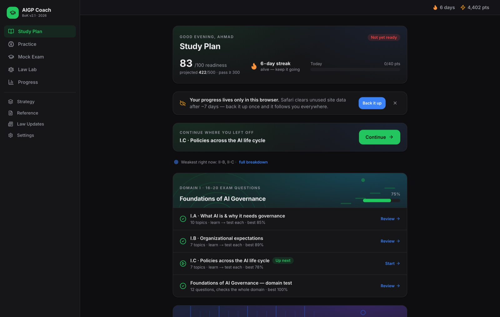
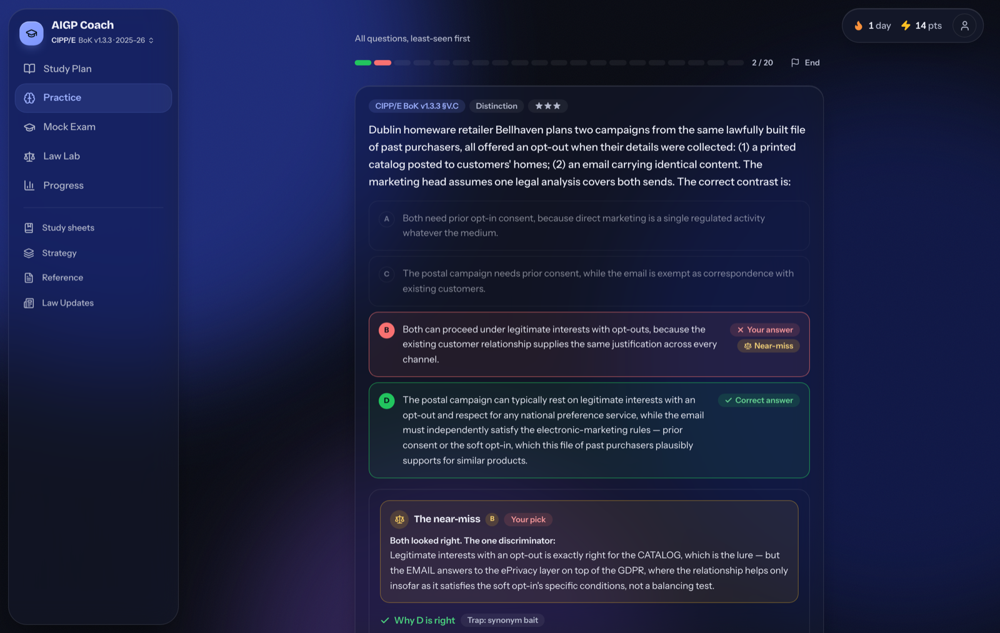
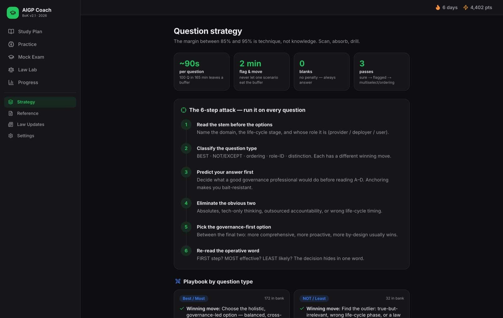
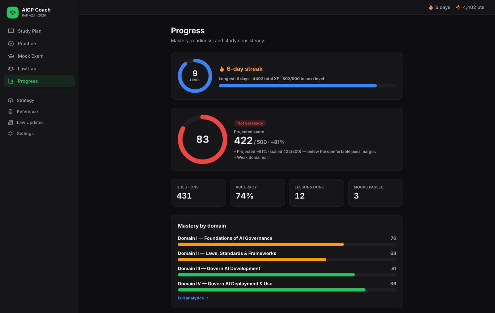
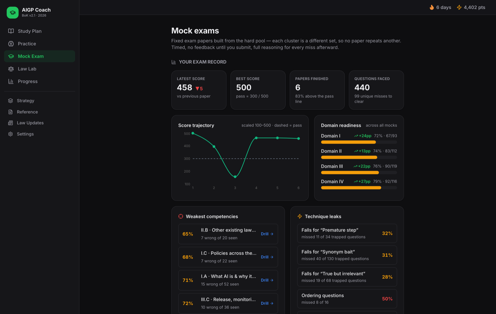
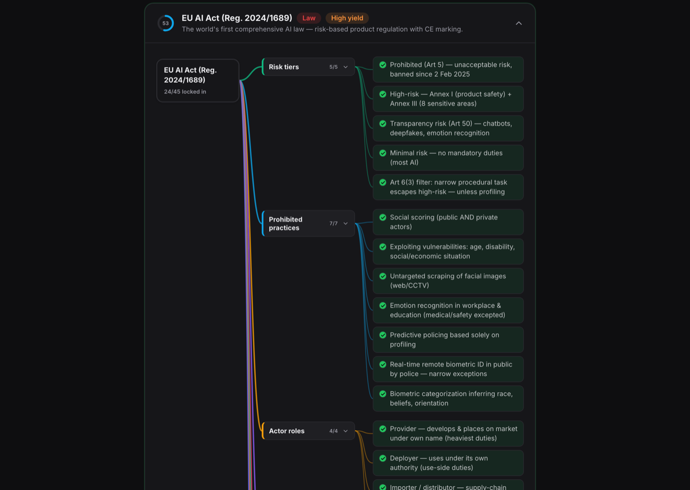
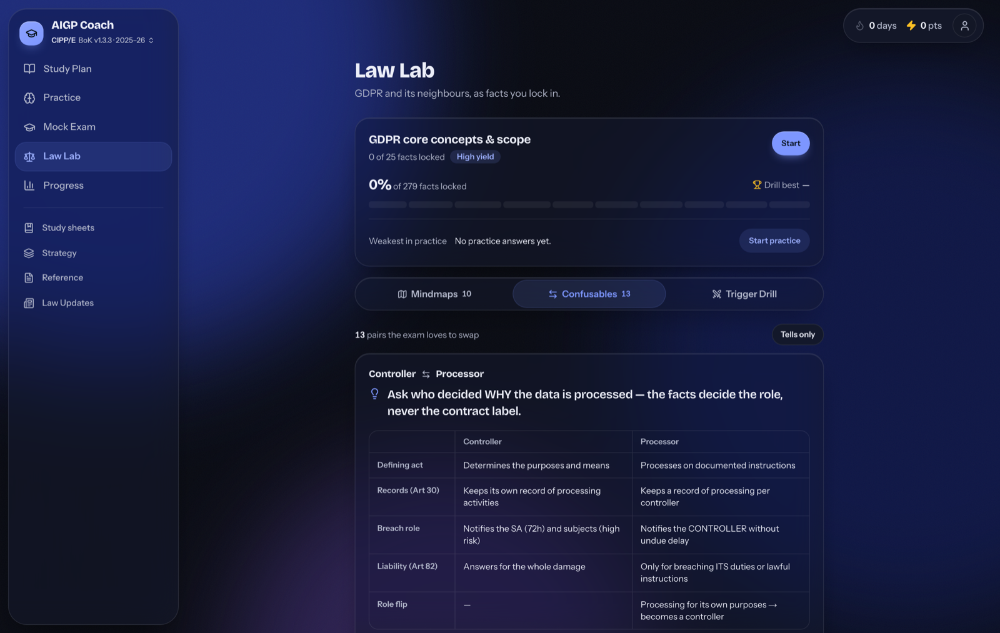

# AIGP Coach

**A study system for the IAPP AIGP exam, built because the material I could buy told me *what* to know and never *why I kept getting questions wrong*.**

Use the hosted copy at **[aigp-coach.vercel.app](https://aigp-coach.vercel.app)**, or clone it and run your own. No accounts, no tracking, no API keys, no configuration. Your progress stays in your browser.

```bash
git clone https://github.com/mahfzal87/aigp-coach.git
cd aigp-coach
npm install
npm run dev
```

Then open **http://localhost:3000**. That is the whole setup. Node 20 or later.



---

## The problem

I was preparing for the IAPP's AI Governance Professional exam. The material I could get had two gaps I could not work around.

The first is that question banks tell you the answer, not the reasoning. You learn that C was right. You do not learn why B was the trap, and you certainly do not learn that you fall for that exact trap every single time a scenario mentions deployer obligations.

The second is that AI law does not sit still. The EU AI Act's obligations phase in on different dates, those dates were themselves amended in July 2026, and US state law moves every quarter. A PDF bought in January is wrong by June, and it has the decency to say nothing about which parts.

So I could not answer the only question that mattered: **am I ready to sit this, and if not, what specifically is broken?**

## The approach

I built the thing I wanted. Three decisions shaped it.

**Diagnose the miss, not the answer.** Every question carries a rationale, a line on why each wrong option fails, and a trap type. After answering I tag the miss as Knowledge, Technique, or Read-error: I did not know it, I knew it and attacked the question wrong, or I simply misread the stem. Those three need completely different remedies, and lumping them together is why "just do more questions" stops working somewhere around the fourth hundred.



**Treat exam technique as its own skill.** Past a certain point the gap is not knowledge, it is how you read a sentence that has been deliberately built to be read wrong. So question type is a first-class attribute (Best/Most, NOT/Least, ordering, role-ID, distinction, recall), each with its own playbook and its own drill.



**Make readiness a number with reasons attached.** The dashboard projects a scaled score against the pass mark, gives a Ready / Almost / Not-yet verdict, and then names the competencies dragging it down. Confidence is captured per question, so the analytics can surface overconfidence, which is high certainty paired with low accuracy, and which is the pattern that fails people.



**Fixed papers, where the record is the product.** The mock module is a cluster of fixed, mutually disjoint papers rather than random pulls: three blueprint-proportional 100-question forms, a 50-question Hard Gauntlet rated hardest throughout, a Trap Lab where every item carries a named trap, and a 25-question deep-dive per domain. Papers run on real exam timing, pause cleanly mid-run, and give no feedback until submission, then full reasoning for every miss. The mock homescreen keeps the whole record: score trajectory against the pass line, per-domain readiness with trend, weakest competencies, technique leaks, and a vault of every question ever missed.



**The laws get their own room.** Two days out from the exam my misses all had the same shape: laws, frameworks, and the deliberate confusion between them. Law Lab is the answer. Every instrument on the Body of Knowledge gets a tappable mindmap (15 maps, 233 facts you lock in one by one as you learn them cold), trigger keywords that map exam phrasing to the right law, 12 side-by-side tables for the pairs the exam loves to swap (DPIA vs FRIA, provider vs deployer, the two compute thresholds), and a timed trigger drill with a personal best. The red strip at the top is live: it names your weakest law competencies from your own attempt history, so the tab always opens with the reason it exists.





## What it does

| | |
|---|---|
| **Learn** | 101 topics mapped to the Body of Knowledge v2.1, plain-English explanations, spaced-repetition flashcards, granular resume down to the exact question inside a lesson |
| **Practice** | 406 original questions, filterable by competency, type, difficulty, unseen, or previously-wrong — every answer comes with the rationale and a why-the-others-fail breakdown |
| **Mock exam** | Nine fixed papers: three full 100-question forms, a Hard Gauntlet, a Trap Lab, four domain deep-dives. Timed, pausable, scaled scoring, insights homescreen, miss vault |
| **Law Lab** | 15 law/framework mindmaps with 233 lockable facts, trigger keywords, 12 confusable tables, a timed trigger drill |
| **Strategy** | Six-step question attack, playbooks and drills per question type |
| **Analytics** | Mastery by competency, the Knowledge/Technique/Read-error split, confidence calibration, time per question |
| **Reference** | A 106-term glossary, every framework broken into its distinct sections, and a dated law-updates feed so stale content is visible rather than silently rotting |

Coverage: 4 domains, 13 competencies, 6 question types, 101 topics, 406 questions (224 of them in a separate hard pool the mock papers draw from), 33 flashcards, 106 glossary terms, 233 Law Lab facts.

**Stack:** Next.js 16, TypeScript, Tailwind v4, Zustand, Recharts, Framer Motion. Progress lives in `localStorage`. There are no accounts, and nothing is sent anywhere unless you mint a sync code (below).

## Running it

Everything is bundled, so `npm install && npm run dev` really is the whole thing. No configuration, no key, no network calls at runtime.

**Deploy your own instance** if you want it on your phone. It is a standard Next.js app, so anything that runs Next will do:

```bash
npm run build && npm start
```

**There is a hosted copy at [aigp-coach.vercel.app](https://aigp-coach.vercel.app).** Your progress still never leaves your browser — the server only serves the app. If you want the same progress on two devices, Settings can mint an anonymous sync code (random, unguessable, no email, no account) that backs your progress blob up under that code; enter it on the other device to restore. Without a code, nothing is sent anywhere.

**Optional:** Supabase can be wired in for the sync codes and for content updates without a redeploy. Off by default in a clone. Notes in [DEPLOY.md](DEPLOY.md).

## Make it your own

The content is the actual product, and it is all plain TypeScript in `/content`:

| File | What is in it |
|---|---|
| `curriculum.ts` | Domains and competencies, with the exam blueprint weights |
| `topics-i.ts` … `topics-iv.ts` | The 101 topic explanations |
| `questions*.ts` | The practice question bank |
| `exam-pool-*.ts` | The hard pool the fixed mock papers are built from |
| `lawlab.ts` | The Law Lab: mindmaps, keywords, confusables, traps |
| `glossary.ts` | The 106-term glossary |
| `flashcards.ts` | Spaced-repetition cards |
| `updates.ts` | The law-updates feed |

Add your own questions, correct mine, or rewrite the topics in your own words, which is the version that sticks. If you fix something wrong, a PR is welcome.

## What I would do differently

**I built content and product at the same time, and content won.** Roughly two thirds of the effort went into writing questions and topic explanations rather than into the app. That was the right call for a study tool with one user. It was not the thing I had been telling myself I was doing. I thought I was building a product. I was building a textbook with a progress bar.

**The readiness score is under-validated.** It projects a scaled score from a weighted competency model I designed myself. The weights come from the published blueprint so the shape is defensible, but I have no outcome data to calibrate against, and one person's result is never going to provide any. I would still rather ship a number with visible reasoning than a soothing "you're doing great." I should have put an honest error bar on it instead of a clean integer that looks like it knows something. *Postscript: the model now has exactly one data point. I sat the retake and passed. n=1 validates nothing, but I am keeping it.*

**Spaced repetition is bolted on, not designed in.** Flashcards run SM-2 on their own schedule while the question bank tracks mastery separately. They should have been one scheduler over one pool of items. Splitting them was a modelling shortcut on day two that got expensive by week six.

**Freshness is manual, which is the real product risk.** The law-updates feed is exactly as current as the last time I edited a file. For a domain that decays this fast, the honest design is an ingestion pipeline with source links and review dates, not an array I maintain by hand. I scoped an in-app fetcher, looked at how much of it I would finish, and left it switched off rather than shipping half.

## Credits and provenance

Some of these questions are mine. The rest are adapted from AIGP study material that circulates freely among candidates, and they carry a `community` tag in the source so you can see which is which.

I cannot trace those items back to an original author. That is a real limitation, not a disclaimer, and it is why this is shared for personal study rather than sold. If you published something I have adapted and want it credited differently or removed, open an issue and I will action it.

Everything here is written against the published Body of Knowledge. If you are looking for recalled exam questions, this is the wrong repo, and honestly the wrong approach.

## Disclaimer

Not affiliated with, endorsed by, or connected to the IAPP in any way. AIGP and CIPP are trademarks of the International Association of Privacy Professionals. This is an independent study aid I built for my own preparation and shared as-is. Nothing here is legal advice.

## Licence

Code is MIT. Study content is shared for personal, non-commercial study use. Details in [LICENSE](LICENSE).
