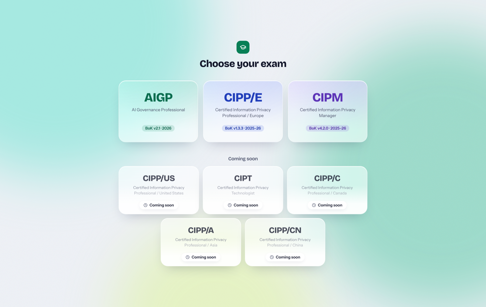
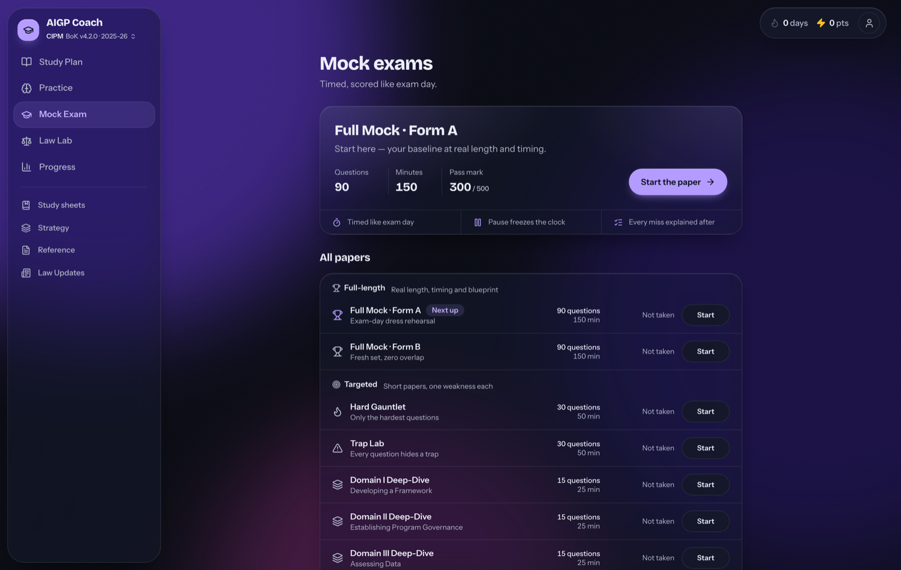
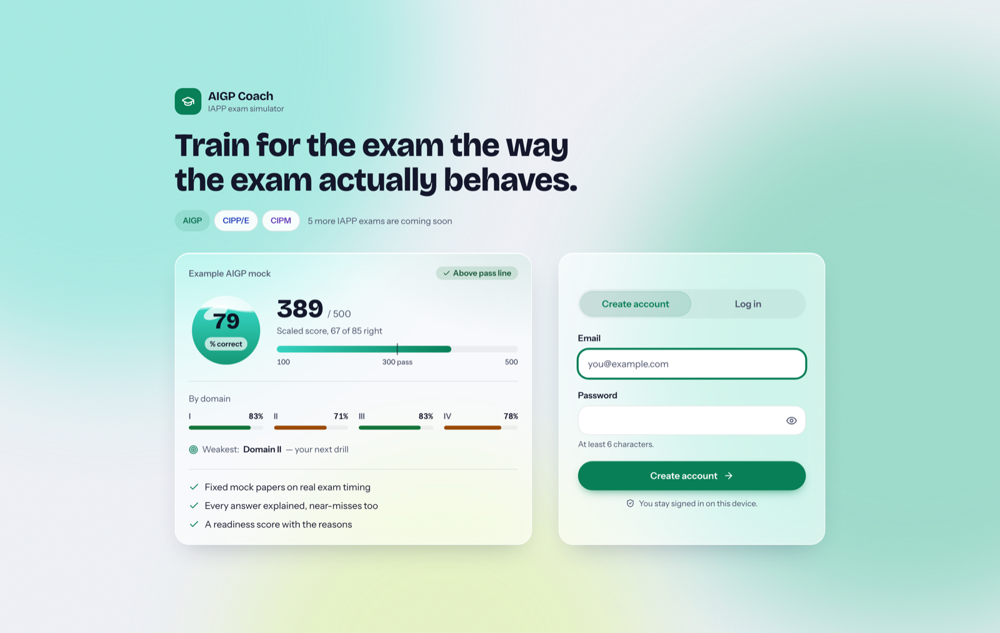

# AIGP Coach

**An exam simulator for IAPP certifications, built because the material I could buy told me *what* to know and never *why I kept getting questions wrong*.**

It started as a study system for the AIGP exam. It now runs three exams, **AIGP**, **CIPP/E** and **CIPM**, and the rest of the IAPP lineup is queued on the exam picker.

Use the hosted copy at **[aigp-coach.vercel.app](https://aigp-coach.vercel.app)**: create a free account, tell it your first name, pick your exam, and go. Your progress backs up to your account automatically and you stay signed in until you log out. Or clone it and run your own with **no account at all**. A clone keeps everything in your browser: no tracking, no API keys, no configuration.

```bash
git clone https://github.com/mahfzal87/aigp-coach.git
cd aigp-coach
npm install
npm run dev
```

Then open **http://localhost:3000**. That is the whole setup. Node 20 or later.


---

## The problem

I was preparing for the IAPP's AI Governance Professional exam. The material I could get had two gaps I could not work around.

The first is that question banks tell you the answer, not the reasoning. You learn that C was right. You do not learn why B was the trap, and you certainly do not learn that you fall for that exact trap every single time a scenario mentions deployer obligations.

The second is that AI law does not sit still. The EU AI Act's obligations phase in on different dates, those dates were themselves amended in July 2026, and US state law moves every quarter. A PDF bought in January is wrong by June, and it has the decency to say nothing about which parts.

So I could not answer the only question that mattered: **am I ready to sit this, and if not, what specifically is broken?**

## The approach

I built the thing I wanted. Five decisions shaped it.

**Diagnose the miss, not the answer.** Every question carries a rationale, a line on why each wrong option fails, and a trap type. After answering I tag the miss as Knowledge, Technique, or Read-error: I did not know it, I knew it and attacked the question wrong, or I simply misread the stem. Those three need completely different remedies, and lumping them together is why "just do more questions" stops working somewhere around the fourth hundred.

The CIPP/E and CIPM packs go one step further. Real papers come down to two options that both look right, so every question in them is written around a named near-miss: an option that is true in general and wrong here on one precise point. Pick it and the reveal says so, then spells out the one discriminator between the two.


**Treat exam technique as its own skill.** Past a certain point the gap is not knowledge, it is how you read a sentence that has been deliberately built to be read wrong. So question type is a first-class attribute (Best/Most, NOT/Least, ordering, role-ID, distinction, recall), each with its own playbook and its own drill. The strategy page opens on your weakest type, one tap from a drill.


**Make readiness a number with reasons attached.** The readiness score is a liquid orb that fills as you improve, next to a projected scaled score against the pass mark. The verdict only turns to Ready when three things hold: the projection clears 466, a safe margin above the 300 pass mark; every domain sits at 80 or better; and you have sat a full-length mock. Until then the page names the competencies dragging you down, each with its own drill. Confidence is captured per question, so the analytics can surface overconfidence, which is high certainty paired with low accuracy, and which is the pattern that fails people.


**Fixed papers, where the record is the product.** The mock module is a cluster of fixed, mutually disjoint papers rather than random pulls. AIGP has three blueprint-proportional 100-question forms, a 50-question Hard Gauntlet rated hardest throughout, a 40-question Trap Lab where every item carries a named trap, and a 25-question deep-dive per domain. CIPP/E has a 90-question form, its own Gauntlet and Trap Lab, and five domain deep-dives. CIPM has two 90-question forms, a Gauntlet, a Trap Lab and six domain deep-dives. Papers run on real exam timing, pause cleanly mid-run, and give no feedback until submission, then full reasoning for every miss. The mock homescreen keeps the whole record: score trajectory against the pass line, per-domain readiness with trend, weakest competencies, technique leaks, a vault of every question ever missed, and the paper to sit next.


**The laws get their own room.** Two days out from the exam my misses all had the same shape: laws, frameworks, and the deliberate confusion between them. Law Lab is the answer. Every instrument on the Body of Knowledge gets a tappable mindmap of facts you lock in one by one as you learn them cold (16 maps and 233 facts for AIGP, 10 maps and 279 facts for CIPP/E, 12 maps and 281 facts for CIPM), trigger keywords that map exam phrasing to the right law, side-by-side tables for the pairs the exam loves to swap (DPIA vs FRIA, provider vs deployer, controller vs processor, PIA vs DPIA), and a timed trigger drill with a personal best. The top card is live: it names your weakest law competencies from your own attempt history, so the tab always opens with the reason it exists.


## More than one exam

Every exam lives in the app as a self-contained content pack: curriculum, question bank, fixed mock papers, Law Lab, glossary. Each keeps its own progress, streak, mocks and readiness model, driven by its official blueprint weights, and the switcher under the logo moves between them without mixing anything up.

**AIGP** is the original, full-depth pack. **CIPP/E** (BoK v1.3.3, the five-domain 2025–26 structure) is the second, written to the near-miss standard from its first question. **CIPM** (BoK v4.2.0, in force since September 2025) is the third, and the first with six domains. It is a program-management exam rather than a law exam, so most of its questions are scenarios about running a privacy program: what to do FIRST, who owns a task, which assessment or metric fits. **CIPP/US, CIPT, CIPP/C, CIPP/A and CIPP/CN** sit on the picker as coming soon.





## The interface

The first version looked like what it was: a textbook with a progress bar. The current one takes its idea from the subject. AI governance and data protection both come down to transparency, so the interface is made of glass: frosted panels over a soft field of light. Each exam has its own light, a lagoon green for AIGP, a European blue for CIPP/E and amethyst for CIPM, so you know which exam you are in without reading a label. Navigation is a floating glass rail with a lens that slides to the page you pick, and a dock on phones. Everything personal sits behind the avatar in the top-right corner: profile, settings, colour mode and sign out.

Light and dark are designed as a pair, contrast is measured rather than eyeballed, focus rings are always visible, and the motion stops when your system asks for reduced motion.

## What it does

| | |
|---|---|
| **Learn** | Topics mapped to each Body of Knowledge in plain English, each with a worked example and its questions straight after; spaced-repetition flashcards; resume down to the exact question inside a lesson |
| **Practice** | Questions filterable by competency, type, difficulty, unseen, or previously wrong. Every answer comes with the rationale and why each other option fails |
| **Mock exam** | Fixed, disjoint papers on real exam timing: full forms, a Hard Gauntlet, a Trap Lab and a deep-dive per domain. Pausable, scaled scoring, an insights homescreen, a vault of every miss |
| **Law Lab** | Law and framework mindmaps with lockable facts, trigger keywords, confusable tables, a timed trigger drill |
| **Strategy** | A six-move question attack, with a playbook and a drill per question type |
| **Analytics** | Mastery by competency, the Knowledge/Technique/Read-error split, confidence calibration, time per question |
| **Reference** | A glossary, every framework broken into its distinct sections, a timeline, a penalty ladder, and a dated law-updates feed so stale content is visible rather than silently rotting |

Coverage per exam:

| | AIGP | CIPP/E | CIPM |
|---|---|---|---|
| Body of Knowledge | v2.1, 2026 | v1.3.3, 2025–26 | v4.2.0, 2025–26 |
| Real exam | 100 questions, 165 minutes | 90 questions, 150 minutes | 90 questions, 150 minutes |
| Domains / competencies | 4 / 13 | 5 / 18 | 6 / 21 |
| Topics | 101 | 60 | 54 |
| Questions | 406, of which 211 sit in the hard pool the mock papers draw from | 202, of which 108 sit in the hard pool | 227, of which 119 sit in the hard pool |
| Fixed mock papers | 9 | 8 | 10 |
| Law Lab | 16 maps, 233 facts, 12 confusable pairs | 10 maps, 279 facts, 13 confusable pairs | 12 maps, 281 facts, 14 confusable pairs |
| Glossary | 105 terms | 90 terms | 93 terms |
| Flashcards | 33 | 24 | 24 |

All three exams are scored on the IAPP's 100 to 500 scale with the pass at 300, and all three use the same six question types.

**Stack:** Next.js 16, TypeScript, Tailwind v4, Zustand, Framer Motion, Recharts, with Bricolage Grotesque and Instrument Sans for type. Supabase is optional and powers accounts, sync and content updates. Progress lives in `localStorage` first; nothing is sent anywhere unless you create an account or mint a sync code (both below).

## Running it

Everything is bundled, so `npm install && npm run dev` really is the whole thing. No configuration, no key, no network calls at runtime.

**Deploy your own instance** if you want it on your phone. It is a standard Next.js app, so anything that runs Next will do:

```bash
npm run build && npm start
```

**The hosted copy at [aigp-coach.vercel.app](https://aigp-coach.vercel.app) is account-first.** Register or log in with an email and password (instant, no confirmation email), set your first name, choose an exam, study. Progress backs up to your account automatically a few seconds after each change and follows you to any device; sessions refresh themselves, so you stay signed in until you log out. The anonymous **sync code** still exists in Settings as a second restore path. **Clones run open by default**, with no login screen and progress in `localStorage` only, and flip to the account-first flow with `NEXT_PUBLIC_REQUIRE_AUTH=true`.



**Optional:** one free Supabase project powers the accounts, the sync codes, and content updates without a redeploy. All of it is off by default in a clone: copy `.env.example` to `.env.local`, run the three SQL files in `supabase/`, and it switches on. Step-by-step in [DEPLOY.md](DEPLOY.md). There is no LLM key to configure anywhere, because nothing in the app calls a model.

## Make it your own

The content is the actual product, and it is all plain TypeScript. Each exam is a pack under `content/exams/<slug>/`, assembled in its `pack.ts` and registered in `lib/exam-registry.ts`, so adding a certification never touches a page. A new pack also needs its slug in `EXAM_SLUGS` (`lib/exam-state.ts`), its own light in `app/globals.css`, and its name taken off the coming-soon list in `components/entry-flow.tsx`.

The AIGP pack's files still live in `/content`, their home from before there was more than one exam:

| File | What is in it |
|---|---|
| `curriculum.ts` | Domains and competencies, with the exam blueprint weights |
| `topics-i.ts` … `topics-iv.ts` | The 101 topic explanations |
| `questions*.ts` | The practice question bank |
| `exam-pool-*.ts` | The hard pool the fixed mock papers are built from |
| `lawlab.ts` | The Law Lab: mindmaps, keywords, confusables, traps |
| `glossary.ts` | The 105-term glossary |
| `flashcards.ts` | Spaced-repetition cards |
| `updates.ts` | The law-updates feed |

CIPP/E and CIPM use the same shapes in `content/exams/cippe/` and `content/exams/cipm/`, split by domain: `topics-d1.ts`, `questions-d1.ts` and so on, one pair per domain (each questions file carries its share of the hard pool), plus `lawlab.ts`, `library.ts`, `flashcards.ts` and `updates.ts`.

Add your own questions, correct mine, or rewrite the topics in your own words, which is the version that sticks. If you fix something wrong, a PR is welcome.

## What I would do differently

**I built content and product at the same time, and content won.** Roughly two thirds of the effort went into writing questions and topic explanations rather than into the app. That was the right call for a study tool with one user. It was not the thing I had been telling myself I was doing. I thought I was building a product. I was building a textbook with a progress bar.

**The readiness score is under-validated.** It projects a scaled score from a weighted competency model I designed myself. The weights come from the published blueprint so the shape is defensible, but I have no outcome data to calibrate against, and one person's result is never going to provide any. I would still rather ship a number with visible reasoning than a soothing "you're doing great." I should have put an honest error bar on it instead of a clean integer that looks like it knows something. *Postscript: the model now has exactly one data point. I sat the retake and passed. n=1 validates nothing, but I am keeping it.*

**Spaced repetition is bolted on, not designed in.** Flashcards run SM-2 on their own schedule while the question bank tracks mastery separately. They should have been one scheduler over one pool of items. Splitting them was a modelling shortcut on day two that got expensive by week six.

**The second exam was retrofitted, not designed in.** The app was built for one exam, and the second arrived as per-exam storage keys threaded through stores that assumed there would only ever be one. It works, but the seams showed: a review during the redesign found two ways progress could land in the wrong place, one where sync could pour one exam's history into the other, and one where a stale browser tab could overwrite newer work. Both are fixed. It is the flashcard lesson again: a shortcut early on, paid for later.

**Freshness is manual, which is the real product risk.** The law-updates feed is exactly as current as the last time I edited a file. For a domain that decays this fast, the honest design is an ingestion pipeline with source links and review dates, not an array I maintain by hand. I scoped an in-app fetcher, looked at how much of it I would finish, and left it switched off rather than shipping half.

## Credits and provenance

Most of these questions are mine. On AIGP, 71 of the 406 are adapted from AIGP study material that circulates freely among candidates, and they carry a `community` tag in the source so you can see which is which. The CIPP/E and CIPM packs are original throughout.

I cannot trace those adapted items back to an original author. That is a real limitation, not a disclaimer, and it is why this is shared for personal study rather than sold. If you published something I have adapted and want it credited differently or removed, open an issue and I will action it.

Everything here is written against the published Bodies of Knowledge. If you are looking for recalled exam questions, this is the wrong repo, and honestly the wrong approach.

## Disclaimer

Not affiliated with, endorsed by, or connected to the IAPP in any way. AIGP, CIPP, CIPM and CIPT are trademarks of the International Association of Privacy Professionals. This is an independent study aid I built for my own preparation and shared as-is. Nothing here is legal advice.

## Licence

Code is MIT. Study content is shared for personal, non-commercial study use. Details in [LICENSE](LICENSE).
